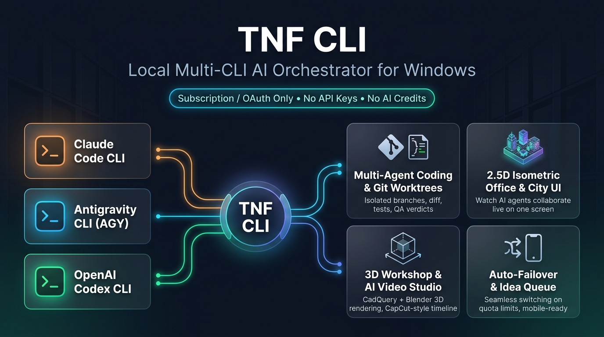
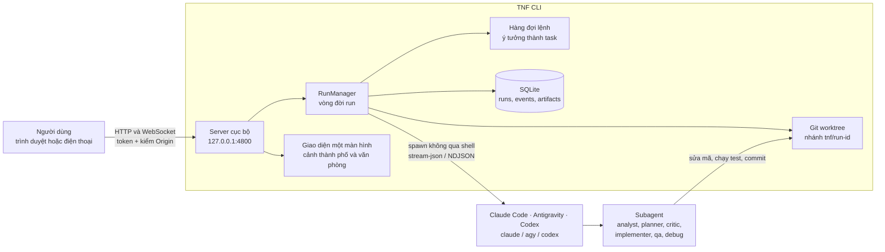
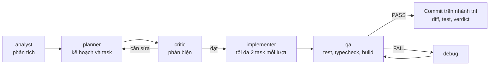
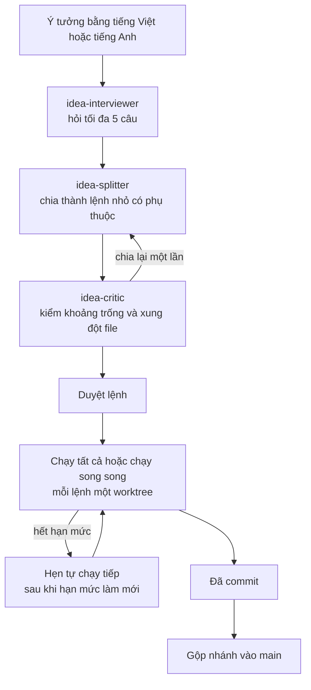

<div align="center">

<picture>
  <source media="(prefers-color-scheme: dark)" srcset="docs/assets/logo-white.png">
  
</picture>

# TNF CLI

**Ra lệnh bằng một câu tiếng Việt hoặc tiếng Anh. Một đội agent từ Claude Code, Antigravity CLI và OpenAI Codex CLI làm việc trên repo của bạn, bạn xem từng vai làm gì ngay trên một màn hình.**

[English](README.en.md) | Tiếng Việt

[](LICENSE)
[](#cài-đặt)
[](#chạy-từ-mã-nguồn)
[](package.json)
[](https://github.com/sponsors/tnfrenzy)

</div>

---



App web chạy **cục bộ trên Windows**, điều phối **3 AI CLI** bằng **tài khoản thuê bao / OAuth** — **không dùng API Key và không dùng gói AI Credit**:
- **[Claude Code CLI](https://docs.claude.com/en/docs/claude-code)** (`claude -p`) — hỗ trợ nhiều tài khoản cô lập qua `CLAUDE_CONFIG_DIR`.
- **Antigravity CLI** (`agy`) — đăng nhập Google OAuth, ép tắt AI Credit (`useG1Credits: false`).
- **OpenAI Codex CLI** (`codex`) — đăng nhập ChatGPT (`codex login`), hỗ trợ nhiều tài khoản cô lập qua `CODEX_HOME`.

Một phiên điều phối các subagent (phân tích, lập kế hoạch, phản biện, viết mã, kiểm thử, gỡ lỗi) hoặc **phối hợp đa pha nhiều CLI trên cùng một git worktree** để repo chính luôn sạch.

## Điểm nổi bật

| | |
|---|---|
| **Đa CLI & quản lý nhiều tài khoản** | Hỗ trợ đồng thời Claude Code, Antigravity CLI và OpenAI Codex CLI; cô lập hồ sơ riêng (`CLAUDE_CONFIG_DIR` / `CODEX_HOME`), tự chuyển dự phòng khi chạm hạn mức, tự ánh xạ model theo vai. |
| **Một câu lệnh, cả đội làm việc** | Gõ yêu cầu bằng tiếng Việt hoặc tiếng Anh, controller chia vai analyst, planner, critic, implementer, qa, debug (có thể gán CLI riêng cho từng vai) và theo dõi từng bước. |
| **An toàn với repo thật** | Mỗi run lập trình chạy trong worktree và nhánh `tnf/<run-id>`, agent được commit nhưng **bị cấm push**, `rm -rf`, `reset --hard`. |
| **Bằng chứng sau mỗi run** | Diff, kết quả test, verdict của qa, mốc commit, bình luận theo dòng và nút "Tiếp tục từ đây". |
| **Hàng đợi ý tưởng → task** | Một ý tưởng được hỏi lại, chia thành lệnh nhỏ có phụ thuộc, phản biện, rồi chạy tuần tự hoặc song song. |
| **Tự chạy tiếp khi hết hạn mức** | Gặp giới hạn 5 giờ, app hẹn giờ và tiếp tục đúng phiên cũ sau khi hạn mức làm mới. |
| **Thấy agent đang làm gì** | Cảnh thành phố (có ánh sáng tầng đang hoạt động), văn phòng 2.5D isometric với nhịp thở/gõ phím sống động từng vai. |
| **Dùng từ điện thoại** | Giao diện co theo khung 375 px, đính kèm tệp, tải kết quả, qua đường hầm có xác thực (Tailscale). |
| **Xưởng dựng video AI (bản demo)** | Viết kịch bản bằng AI từ một biểu mẫu, dựng timeline kiểu CapCut (chuyển cảnh, chuyển động ảnh, phụ đề, lời thoại, nhạc nền tự giảm tiếng), xem thử nhanh theo đoạn rồi xuất MP4 bằng ffmpeg. |
| **Nối công cụ ngoài** | Kết nối MCP, cấp quyền theo môi trường, xưởng dựng 3D (CadQuery + Blender), Xem trước giao diện bằng ảnh chụp. |
| **Minh bạch chi phí** | Token và chi phí hiển thị là **ước tính**, luôn ghi rõ trên giao diện. |

## Sơ đồ chức năng

### Kiến trúc tổng quan



### Vòng đời một run lập trình



### Từ ý tưởng đến mã đã gộp



## Cài đặt

### Bằng Setup.exe (khuyên dùng, không cần Node)

1. Tải `TNF-CLI-Setup-<phiên bản>.exe` ở mục **Releases**, chạy. Bộ cài **không cần quyền admin**, cài vào `%LOCALAPPDATA%\TNF\Controller`, có biểu tượng ở khay hệ thống.
2. Máy cần sẵn: **ít nhất một AI CLI đã đăng nhập** bằng gói thuê bao/OAuth (Claude Code `claude auth status`, Antigravity `agy`, hoặc OpenAI Codex `codex login`), và **Git for Windows** trong PATH.
3. Mở **TNF CLI** từ Start Menu. Muốn thử không tốn hạn mức, chọn lối tắt **chế độ demo**.

Cài đè bản mới vẫn giữ `data\`, `workspace\` và `controller.json`.

### Chạy từ mã nguồn

Yêu cầu: Windows, Node.js ≥ 22.5, Git for Windows, và ít nhất một CLI đã đăng nhập thuê bao/OAuth (không dùng `ANTHROPIC_API_KEY` / `GEMINI_API_KEY` / `OPENAI_API_KEY`).

```powershell
git clone https://github.com/tnfrenzy/tnf-cli.git
cd tnf-cli
npm install
.\scripts\start.ps1            # chạy thật
.\scripts\start.ps1 -Demo      # CLI giả, phát lại fixture, không tốn token
```

Server in một địa chỉ dạng `http://127.0.0.1:4800/#token=...`, hãy mở đúng địa chỉ đó (token chỉ in một lần).

### Dựng bộ cài

```powershell
npm run package      # build\app\
npm run installer    # build\TNF-CLI-Setup-<phiên bản>.exe (cần Inno Setup 6)
```

## Xưởng dựng video

> **Bản demo:** đây là tòa nhà thứ 5 trong cảnh thành phố, đang ở mức demo; tính năng còn thiếu và có thể thay đổi.

Tòa nhà **Video** trong cảnh thành phố. Tạo video từ một biểu mẫu (chủ đề, người xem, giọng điệu, ý chính, mẫu nhanh, phong cách), AI đạo diễn lập kế hoạch cảnh, bạn chỉnh trên timeline rồi dựng.

- **Timeline:** tách, nhân đôi, xóa, kéo đổi chỗ, xén clip; hoàn tác và làm lại; chèn hình ảnh hoặc video; thẻ tiêu đề; đổi tỷ lệ 16:9, 9:16, 1:1.
- **Vừa khung:** nền mờ, phủ đầy hoặc viền đen cho từng clip, để hình sai tỷ lệ không bị méo.
- **Chuyển cảnh và chuyển động:** chuyển cảnh riêng từng chỗ nối, zoom hoặc lia cho ảnh, tốc độ clip, giữ tiếng gốc.
- **Chữ:** bật hoặc tắt toàn bộ chữ, kéo chữ ngay trên khung xem, chỉnh cỡ và màu, tạo phụ đề từ lời thoại.
- **Lời thoại:** chọn người đọc (giọng Windows cài trên máy) hoặc tải mp3/wav; chỉnh âm lượng, vào/ra dần, tốc độ, tách và xén; nhạc nền tự nhỏ đi khi có lời.
- **Xem thử:** dựng nhanh độ phân giải thấp, hoặc chỉ đoạn đang chọn (giữ Shift và kéo trên thước).
- **Hồ sơ thông tin AI và thư viện hình ảnh/video dùng chung** giúp AI không bịa tên, số liệu.

Cần [ffmpeg](https://ffmpeg.org/) (tự tìm trong PATH hoặc khai đường dẫn ở Cài đặt Video Studio). Nội dung gửi tới dịch vụ giọng đọc hoặc tạo ảnh chỉ đi khi bạn tự khai dịch vụ đó; giọng Windows chạy hoàn toàn trên máy.

## Dòng lệnh

```powershell
npm run tnf -- status                               # đăng nhập và billing guard
npm run tnf -- accounts list                        # danh sách tài khoản CLI (Claude / Antigravity / Codex)
npm run tnf -- accounts add "Work" --provider codex # thêm tài khoản CLI mới (cô lập hồ sơ riêng)
npm run tnf -- run "Thêm lệnh tnf version" --project controller --provider antigravity
npm run tnf -- projects add controller --repo D:\code\repo --base main
npm run tnf -- list                                 # lịch sử các lần chạy
npm run test:fast                                   # bộ test nhanh (CLI providers, accounts, phased, i18n)
npm test                                            # toàn bộ test suite, không gọi CLI thật
```

## Nguyên tắc an toàn

- Server chỉ lắng nghe `127.0.0.1`; mọi API và WebSocket cần token và được kiểm `Origin`/`Host`.
- Chỉ dùng gói thuê bao / OAuth: xóa toàn bộ API key (`ANTHROPIC_API_KEY`, `GEMINI_API_KEY`, `OPENAI_API_KEY`, ...), ép tắt AI Credit (`useG1Credits: false`), không bao giờ dùng `--bare`, `--dangerously-skip-permissions` hay `--dangerously-bypass-approvals-and-sandbox`.
- Spawn `claude` / `agy` / `codex` không qua shell; không sửa `~/.claude/settings.json`, không cài hook toàn cục.
- Nội dung lấy từ web là dữ liệu không tin cậy, agent không làm theo chỉ dẫn nằm trong đó.
- Cấp quyền theo môi trường là **rào chắn cho agent hợp tác, không phải hộp cát bảo mật**.

## Tài liệu

| Tài liệu | Nội dung |
|---|---|
| [Hướng dẫn Agent (AGENTS.md)](AGENTS.md) | Quy tắc cứng, kiến trúc 3 CLI, bản đồ mã nguồn cho phiên mới (Antigravity / Claude / Codex) |
| [Bàn giao (HANDOVER.md)](docs/HANDOVER.md) | Trạng thái hiện tại và các việc mở |
| [Hướng dẫn chi tiết](docs/GUIDE.md) | Cài đặt, cấu hình, điện thoại, thư viện vai, hàng đợi, Blender |
| [Đặc tả](docs/CONTEXT-SPEC-v1.md) | Đặc tả hiệu lực của hệ thống |
| [Hàng đợi và ý tưởng](docs/PLANNER-QUEUE.md) | Cách chia ý tưởng thành task |
| [Tự chạy tiếp khi hết hạn mức](docs/QUOTA-AUTO-RESUME.md) | Thiết kế hẹn giờ và khôi phục |
| [Xưởng dựng 3D](docs/DESIGN-3D.md) | Agent dựng mẫu 3D và render Blender |
| [Xưởng dựng video](#xưởng-dựng-video) | Cách dùng và giới hạn của dựng video AI |

## Tài trợ

Dự án do một người duy trì. Nếu app giúp ích cho công việc của bạn, bạn có thể ủng hộ qua **[GitHub Sponsors](https://github.com/sponsors/tnfrenzy)**. Cảm ơn bạn.

## Giấy phép

Apache-2.0, xem [LICENSE](LICENSE) và `NOTICE`. Bản quyền 2026 tnfrenzy. Thư viện bên thứ ba giữ giấy phép riêng của chúng.
